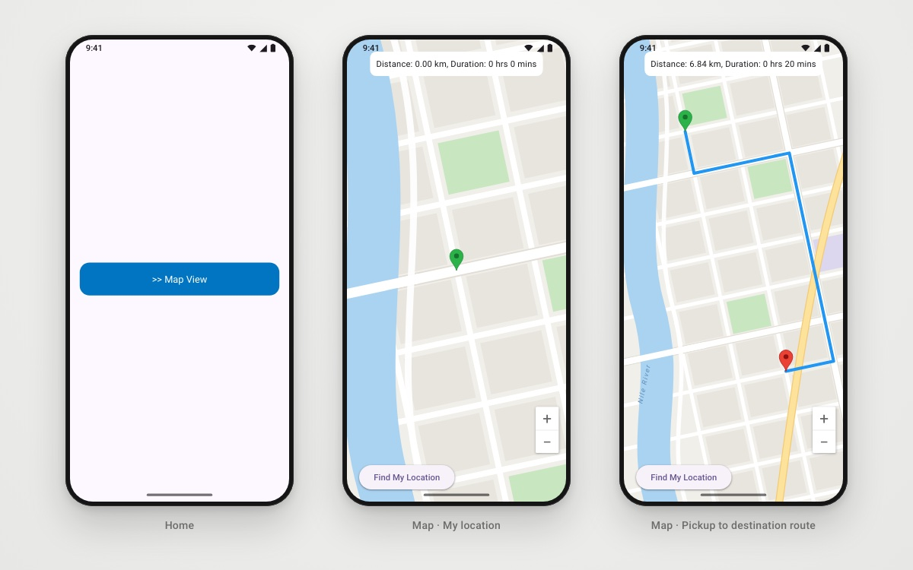

<h1 align="center">Map Route Planner</h1>

<p align="center">Tap a pickup point and a destination on Google Maps to get the driving route, its distance and duration.</p>

<p align="center">
  
  
  
  
  
</p>

<p align="center">
  
  <br/><sub>Home · My location · Pickup to destination route</sub>
</p>

## About

A ride-hailing-style map screen in Flutter. The first tap on the map sets a pickup marker and the second sets a destination. The app then asks the free public **[OSRM](https://project-osrm.org/)** routing service for a driving route, draws it as a polyline and fits the camera to both points. A floating card shows the distance and estimated travel time. A **Find My Location** button uses `geolocator`, with the full permission flow, to set your current position as the pickup.

## ✨ Features

- 🗺️ **Google Map**: opens on Cairo by default.
- 📍 **Pickup and destination markers**: green for pickup, red for destination, with info windows. A third tap starts a new trip.
- 🛣️ **Driving route**: OSRM `route/v1/driving` with GeoJSON geometry, drawn as a blue polyline.
- 📏 **Distance and duration** from the OSRM response, shown in a floating card.
- 🎯 **Auto-fit camera**: animates to `LatLngBounds` around both points.
- 📡 **My location**: checks location services, requests permission (handles denied and permanently denied), then moves to your position at zoom 16.
- ⚠️ **Errors** shown in SnackBars.

## 🛠 Tech stack

| Concern | Choice |
|---|---|
| Maps | `google_maps_flutter` |
| Location | `geolocator` |
| Routing | OSRM public API over HTTP (no key needed) |
| Structure | Feature-first folders, `onGenerateRoute` with a 404 fallback |
| Also included | `flutter_bloc`, `get_it`, `dartz`, `shared_preferences` (a `Prefs` wrapper), `firebase_auth`, `flutter_polyline_points` |

## 🏗 Project structure

```
lib/
├── core/
│   ├── errors/             # Failure, CustomException
│   ├── helper_functions/   # onGenerateRoute, showErrorBar
│   ├── services/           # get_it setup, SharedPreferences wrapper
│   └── widgets/            # custom app bar / button / text field / HUD
├── features/home/presentation/views/
│   ├── home_view.dart
│   ├── map_view.dart
│   └── widgets/map_view_body.dart   # map, markers, OSRM route, location
└── main.dart
```

## 🚀 Getting started

**Prerequisites:** Flutter SDK (Dart `^3.9.0`) and a Google Maps SDK for Android API key.

1. Set your key in `android/gradle.properties` (or `~/.gradle/gradle.properties`). `android/app/build.gradle.kts` reads it into the manifest placeholder:

   ```properties
   MAPS_API_KEY=your_google_maps_api_key
   ```

2. Run the app:

   ```bash
   git clone https://github.com/youssef336/Map.git
   cd Map
   flutter pub get
   flutter run
   ```

> iOS: the Maps key is not configured yet. Add `GMSServices.provideAPIKey(...)` in `ios/Runner/AppDelegate.swift` and a location-usage description in `Info.plist` before running on iOS.

## 👤 Author

**Youssef Belal Zakaria** · [GitHub @youssef336](https://github.com/youssef336)

⭐ If you like this project, give it a star!
